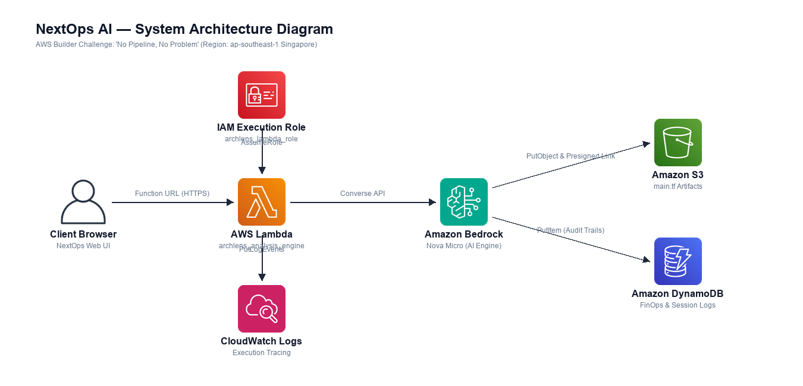

# ⚡ No Pipeline, No Problem: An Instant Serverless CloudOps, FinOps & DevSecOps Agent on Amazon Bedrock

[](https://aws.amazon.com/)
[](https://aws.amazon.com/bedrock/)
[](https://www.terraform.io/)
[](https://www.python.org/)
[]()

> **Submission for the AWS Builder Community Challenge: *"Weekend Challenge: No Pipeline, No Problem"***

---

## 🌟 Executive Summary

Traditional Infrastructure-as-Code (IaC) governance requires setting up heavy, complex, and costly CI/CD pipelines (GitHub Actions, Checkov runners, Infracost API keys, SonarQube, and dedicated build servers). For students, independent builders, and fast-moving teams, this friction leads to misconfigured architectures, unexpected AWS bills, and security vulnerabilities.

This project proves that with **pure serverless architecture**, we can replace hours of pipeline configuration with an **on-demand, sub-3-second AI CloudOps, FinOps, and DevSecOps Agent** running directly on AWS.

Built using **AWS Lambda Function URLs**, **Amazon Bedrock (Amazon Nova Micro)**, **Amazon DynamoDB**, and **Amazon S3**, the system costs **$0 when idle (*scale-to-zero*)** and runs full architectural reviews for approximately **$0.0001 per invocation**.

---

## 🗺️ System Architecture & Topology



```
[User Browser / Web UI] 
         │ (HTTPS POST)
         ▼
[AWS Lambda Function URL] (Built-in HTTPS & CORS - No API Gateway required)
         │
         ▼
[AWS Lambda: Python 3.12 Engine]
    ├── 1. Region Compliance Policy Validator (Enforces Data Sovereignty)
    ├── 2. Subnet Advisory Consultant (Interactive Placement Clarification)
    └── 3. Amazon Bedrock Converse API (Nova Micro: apac.amazon.nova-micro-v1:0)
         ├── ➔ Generates Regional FinOps Monthly Cost Estimation Table
         ├── ➔ Compiles Production-Ready Terraform Code
         └── ➔ Audits 6 AWS Well-Architected Security Pillars
         │
         ├──► [Amazon S3]: Saves main.tf & main_hardened.tf + Presigned URLs
         ├──► [Amazon DynamoDB]: Persists session history, latency, and scores
         └──► [Amazon CloudWatch]: Real-time execution tracing
```

---

## 🚀 Key Features

### 1. 🏗️ Cloud Architect & Dynamic Multi-Region FinOps Estimator
* **Natural Language Architecture Design:** Converts user prompts into industry-standard Terraform (HCL) configurations.
* **Itemized Monthly Cost Estimation:** Computes realistic monthly cost breakdowns ($/month) customized for the user's target AWS Region (e.g., Jakarta `ap-southeast-3`, Singapore `ap-southeast-1`, US East `us-east-1`).
* **Free Tier Indicators:** Identifies resources eligible for the 12-month AWS Free Tier or Always-Free quotas.
* **Cost-Optimization Advice:** Suggests actionable savings (e.g. ARM Graviton `t4g` processors, Spot instances, avoiding idle NAT Gateways).

### 2. 🛡️ Deterministic Governance & Compliance Guardrails
* **Region Compliance Policy Validator:** Rejects unspecific prompts and requires users to declare their target AWS Region to ensure compliance with data sovereignty regulations (e.g., GDPR, Indonesia UU PDP).
* **Interactive Subnet Advisory:** If a prompt specifies multiple subnets (public and private) with an EC2 instance without placement, the agent pauses and consults the user on whether the instance should be a public ingress web server or an isolated private database backend.

### 3. 🔍 DevSecOps Linter & Automated Code Hardening (6 Security Pillars)
Analyzes user-submitted `.tf` code against CIS AWS Foundations Benchmark & Well-Architected Framework:
1. **Network & Perimeter Security:** Detects `0.0.0.0/0` on sensitive ports (22, 3389, 5432, 3306) and unencrypted HTTP.
2. **IAM & Credential Hygiene:** Flags wildcard permissions (`*`) and plaintext credentials.
3. **Data Protection & Encryption:** Verifies S3 SSE-KMS, EBS volume encryption, and RDS storage encryption.
4. **Public Asset Exposure:** Flags unblocked S3 buckets and publicly accessible databases.
5. **Compute Hardening & SSRF:** Enforces IMDSv2 (`http_tokens = "required"`).
6. **Observability & FinOps:** Checks access logging and orphaned resources.
* **Auto-Remediation:** Automatically delivers a secured, hardened file (`main_hardened.tf`) uploaded directly to Amazon S3 with a 1-hour presigned download link.

---

## 🛠️ Tech Stack & Services

| Service | Role | Cost Profile |
|---|---|---|
| **AWS Lambda Function URL** | Serverless REST Ingress | Free (Built-in to Lambda) |
| **AWS Lambda** | Core Engine (Python 3.12) | Always Free Tier (1M req/month) |
| **Amazon Bedrock (Nova Micro)** | AI Reasoning & Code Gen | ~$0.0001 / request ($0.035/1M input tokens) |
| **Amazon S3** | Artifact Delivery & Storage | Free Tier (5 GB standard storage) |
| **Amazon DynamoDB** | Audit Logs & Session State | Always Free Tier (25 GB capacity) |
| **HashiCorp Terraform** | Infrastructure as Code | Open Source |

---

## 📦 Deployment Instructions

### Prerequisites
* [Terraform v1.5+](https://www.terraform.io/)
* [AWS CLI v2](https://aws.amazon.com/cli/) configured with an active AWS account (`ap-southeast-1` recommended).
* Amazon Bedrock model access granted for **Amazon Nova Micro** in `ap-southeast-1`.

### Step 1: Clone Repository
```bash
git clone https://github.com/LiZUie/No-Pipeline-No-Problem-An-Instant-Serverless-CloudOps-FinOps-DevSecOps-Agent-on-Amazon-Bedrock.git
cd No-Pipeline-No-Problem-An-Instant-Serverless-CloudOps-FinOps-DevSecOps-Agent-on-Amazon-Bedrock
```

### Step 2: Package the Lambda Function
```bash
zip -j lambda.zip lambda_function.py
```

### Step 3: Deploy Infrastructure
```bash
terraform init
terraform apply -auto-approve
```

### Step 4: Launch Web Dashboard
Open `index.html` in any modern web browser:
```bash
open index.html
```

---

## 👤 Author
**Muhammad Arsa Faturrahman Saleh**  
Internet Engineering Technology (Teknologi Rekayasa Internet) — Universitas Gadjah Mada (UGM)  
*Participant in AWS Builder Community Challenge 2026*
